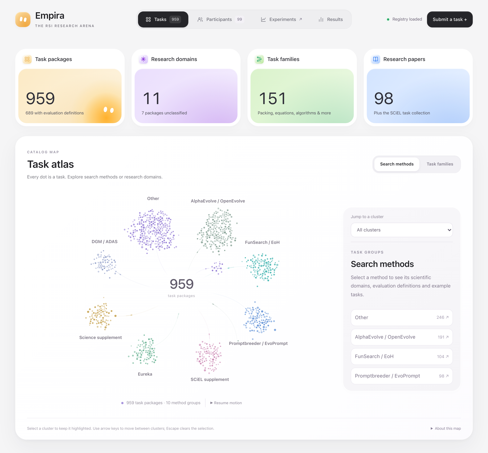

<p>
  
</p>

# Empira

**An arena for research on recursive self-improvement.**

[](tasks/suite)
[](registry/catalog.json)
[](registry/participant-corpus.json)
[](#quick-start)
[](https://huggingface.co/datasets/autoresearchTasksSciel/autoresearch-tasks)

Empira connects scientific tasks, research systems and experiment records to study a specific question: **when do changes to a system’s research methods improve its ability to make further improvements?**

Researchers can inspect the problems a system works on, follow changes to its code and research process, and examine results alongside the resources used to obtain them. Frameworks keep their own search algorithms, memory and learning mechanisms.

<p>
  Made by
  <a href="https://cpil-lab.github.io/"> CPIL Research Group</a>
  at
  <a href="https://mbzuai.ac.ae/"> MBZUAI</a>.
</p>

[Research board](https://research-arena.small-pine-3af7.workers.dev) · [Contributing](CONTRIBUTING.md) · [Code style](CONTRIBUTING.md#code-style) · [Local setup](#quick-start)

[](https://research-arena.small-pine-3af7.workers.dev)

## Release snapshot — v0.1.0

As of **22 September 2026**, the collection contains **959 task packages** across **151 task families** and **11 research domains**, drawing on a **98-paper research corpus** and supplementary scientific collections.

Our contribution is turning research problems into task packages with a shared evaluation interface. Of the **689 packages with executable evaluator definitions**, **81.13% use evaluators implemented or adapted in the task library**; **18.87% reuse upstream evaluators**.

| How evaluation is provided | Task packages | Share of the full catalog |
| --- | ---: | ---: |
| Implemented or adapted in the task library | **559** | **58.29%** |
| Reused from upstream implementations | 130 | 13.56% |
| Research tasks awaiting evaluation integration | 270 | 28.15% |
| **Total** | **959** | **100.00%** |

Evaluator definitions cover **71.85%** of the catalog. **81** adapted definitions are recorded as verified reconstructions. Recorded numeric seed baselines are available for **667 packages (69.55%)**; **75 (7.82%)** include published numeric references.

Counts refer to task packages, including distinct parameter settings and protocols. The split describes evaluator implementation; validation and runtime requirements are recorded separately for each task.

Release data: [task library](tasks/suite), [task catalog](registry/catalog.json), [research domains](registry/insights.json), [reference evidence](registry/references.json).

## Inside the arena

| View | What you can investigate |
| --- | --- |
| **Tasks** | Explore research domains and the task atlas; inspect problem descriptions, evaluator contracts and pinned source evidence. |
| **Participants** | Find research systems, their authors and papers, implementation revisions and available launch profiles. |
| **Experiments** | Follow native SCiEL runs through source changes, candidate lineages, research cells, authored tools, model calls and recorded artifacts. |
| **Results** | Examine solution quality, recorded effort and research activity, with comparisons grouped by evaluator contract and model. |

Results connect back to the experiment evidence. Research-cell creation, code revisions and tool use describe how a run developed; demonstrating recursive improvement also requires evaluating what those changes enable in subsequent experiments.

The catalog includes both research works and executable integrations. A paper entry, a prepared launch environment and a completed evaluation each have their own status. Framework profiles record the supported interface and its requirements.

## Working with Empira

1. **Choose a task.** Review its scientific context, candidate interface and evaluation contract.
2. **Select a system version.** Use a pinned implementation or a private engine release, with a prepared environment and an explicit budget.
3. **Run through an authorized worker.** The worker executes approved queue entries and records their artifacts.
4. **Inspect and compare.** Follow the experiment in the workspace and publish reviewed measurements to Results.

Tasks and system versions enter through GitHub PRs. Run access is granted separately; request a key through the board or contact [arina.kharlamova@mbzuai.ac.ae](mailto:arina.kharlamova@mbzuai.ac.ae). An engine’s repository and container image can remain private: its Arena PR can contain only the system name and version. See [private engine releases](CONTRIBUTING.md#private-engine-releases).

### Catalog campaigns

On a provisioned Linux worker, campaigns move through four stages: **pin the release → check seeds → prepare private templates → admit bounded batches**. The inventory retains all **959 tasks**. Currently **350** match the declared CPU dependency profile; only successful seed receipts for the exact task library and evaluator image make a task eligible for preparation. Prepared templates still require their first native run to establish runtime conformance.

1. **Pin the engine and environment.** Build the private SCiEL image with [`build_sciel_engine.py`](scripts/deployment/build_sciel_engine.py), selecting an immutable source commit and a new Arena version. The current catalog preparer targets `0.2.0+arena.a6c0d215.worker1`. Register and approve its private deployment, and pin the evaluator image by digest. [`build_catalog_cpu_image.py`](scripts/deployment/build_catalog_cpu_image.py) prepares the extended CPU dependencies with a hashed wheel lock.
2. **Check the seeds.** Run the preflight below. It evaluates candidates without calling a model and retains tasks awaiting environment or evaluator integration in its manifest.
3. **Prepare the campaign.** Select an available model from the private Codex gateway’s authenticated `/v1/models` endpoint and verify it with a small live probe. Pass that exact ID with `--model`; model availability is not guaranteed by a script default. Preparation checks seed receipts and creates private configurations, native task packages, templates and a complete campaign inventory without submitting runs.
4. **Admit the batches.** Install the generated templates in the private control configuration, set `max_active` to at most **4**, and reload the control service. Preview admission before adding `--admit`.

Use new absolute output directories. In this example, set `ARENA_CPU_IMAGE`, `ARENA_DEPLOYMENT`, `ARENA_APPROVAL`, `ARENA_MODEL` and `ARENA_WORKER_PYTHON` to the reviewed image digest, deployment file, approval file, model ID and worker interpreter. The task root must match the evaluator broker’s approved mount.

```sh
python scripts/deployment/sciel_catalog_preflight.py \
  --tasks-root /srv/arena/sources/arena-tasks \
  --image "$ARENA_CPU_IMAGE" --output /srv/arena/preflight/catalog-001 \
  --workers 4 --execute-seeds

python scripts/deployment/prepare_sciel_catalog_campaign.py \
  --tasks-root /srv/arena/sources/arena-tasks \
  --preflight-manifest /srv/arena/preflight/catalog-001/manifest.json \
  --deployment "$ARENA_DEPLOYMENT" --approval "$ARENA_APPROVAL" \
  --config-destination /srv/arena/configs/catalog-001 \
  --native-tasks /srv/arena/tasks/catalog-001 \
  --campaign catalog-001 --model "$ARENA_MODEL" --python "$ARENA_WORKER_PYTHON"

python scripts/deployment/submit_sciel_catalog.py \
  --templates /srv/arena/configs/catalog-001/templates.json \
  --control-config /srv/arena/control/config.json \
  --key-file /srv/arena/control/catalog-key.json \
  --campaign catalog-001 --status /srv/arena/control/catalog-001-status.json \
  --batch-size 16
```

The last command previews; repeat with `--admit` to enqueue. Each wave finishes before the next is admitted. Admission pauses when at least 25% of a completed wave fails, native completion evidence reports a stop, or the control configuration changes. It does not cancel runs already admitted. Resume with the same templates, campaign, batch size, status path and control revision; existing run IDs are reused.

For unattended preparation and admission, [`launch_sciel_catalog_campaign.py`](scripts/deployment/launch_sciel_catalog_campaign.py) accepts explicit `--base-preflight` and `--extended-preflight` manifest paths, pilot inventory/status paths, new private configuration/task directories, and separate submission/admin key files. With `--admit`, it waits for both preflights and the completed pilot, excludes pilot tasks, and atomically appends templates with a control backup and reload. Optional `--pilot-conformance` accepts a verified snapshot of canonical evaluation, three confirmation samples and observed model calls while those exact pilot runs continue; this establishes integration evidence, not scientific success. All previous templates and limits remain unchanged. The persisted task order rotates through research domains, starting with physics, chemistry/materials, biology/health and robotics/control, using the catalog’s domain assignments.

Each template specifies a **16 full-evaluation search budget**, 32 iterations, one evaluator slot, 4 CPUs, 8 GiB RAM and a one-hour wall limit. Confirmation uses three samples; research and confirmation activity are recorded separately. Raw task metrics, their direction and canonical signed fitness remain in evaluation receipts. SCiEL’s search score applies an explicit arctangent transform with a seed-receipt-bound scale; this search score is not a cross-task benchmark result.

## Quick start

Requires **Python 3.11+**. From the repository root:

```sh
python3 -m venv .venv
source .venv/bin/activate
python -m pip install -e .
python -m arena
```

Open <http://127.0.0.1:8787>. The local board serves the catalog and published results without model credentials. Native experiment views read existing archives; they do not require the SCiEL engine to be installed.

Task definitions, evaluators, seeds and shared task modules live in [`tasks/`](tasks) and ship with the Python package. Inspect the collection locally:

```sh
python tasks/run.py list
python tasks/run.py show reference-sat
python tasks/run.py doctor reference-sat
```

Workers verify the bundled task files against a SHA-256 manifest before evaluation. Individual tasks can require additional datasets, benchmark packages or native tools; `doctor` reports their declared requirements. See [task development](CONTRIBUTING.md#tasks).

To inspect your own runs, provide their directories:

```sh
python -m arena --root /path/to/outputs --root /path/to/other-runs
```

| URL | View |
| --- | --- |
| `/` | Tasks and research domains |
| `/?view=participants` | Participants and papers |
| `/results` | Published results |
| `/experiments` | Experiment workspace |

The workspace retains its own Results and Queue pages. Queue operations require a configured private control service and a scoped key.

## Architecture

The discovery board and experiment workspace share task, system and result contracts. A Python observer reads native journals, checkpoints and heartbeat files. Execution belongs to a separate Linux worker with bounded resources and private engine/evaluator services.

| Layer | Implementation |
| --- | --- |
| Interface | JavaScript ES modules, HTML and CSS in `web/` |
| Observer and execution services | Python in `src/arena/`; NumPy for numerical projections |
| Edge API | TypeScript on Cloudflare Workers, with Cloudflare Access authentication |
| Registry | Versioned JSON snapshots and schemas in `registry/` and `schemas/` |
| Task library | Scientific task definitions, evaluators and shared modules in `tasks/` |
| Private queue | SQLite-backed control service, worker leases, quotas and cancellation |

The cloud board serves published result snapshots and connects to the private observer through a Cloudflare VPC Service. Experiment views read native run state; published Results change through an explicit export and deployment. The public Worker exposes read-only routes; execution credentials stay on the private side.

The Python package and CLI use the name `arena`. See [running the services](CONTRIBUTING.md#running-the-services) for worker configuration and Cloudflare deployment.

## Validation

For development, install the test dependencies and use **Node 22.12+**:

```sh
python -m pip install -e '.[dev]'
npm ci
npm ci --prefix tests/web
python scripts/check_repository_policy.py
python -m pytest -q
npm run test:web
npm run test:api
npm run typecheck
```

CI also checks generated registry snapshots and package/Worker builds. See the [complete check list](CONTRIBUTING.md#checks). Default tests use fixtures and local transports; Linux execution conformance has separate opt-in checks.
